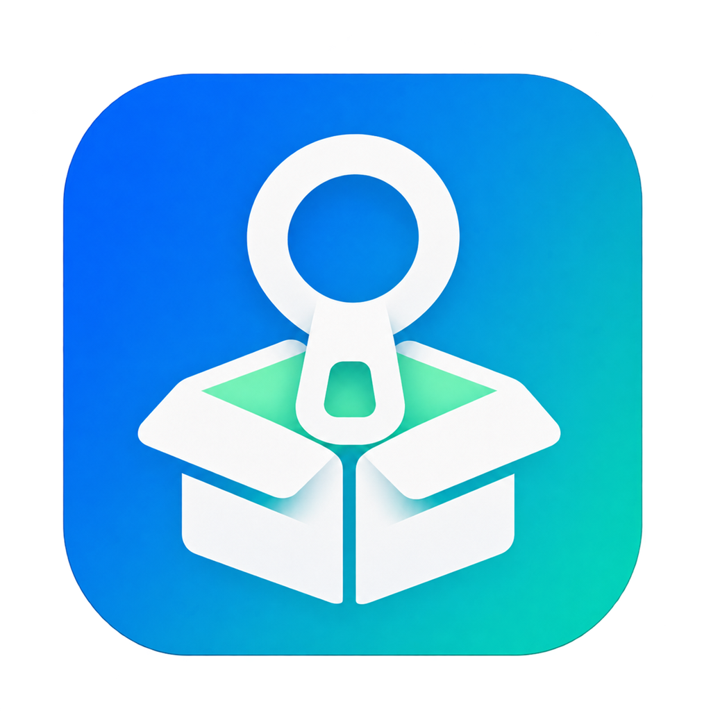

# 轻解

**[下载轻解 0.14.0（Windows x64 完整发布包）](https://github.com/boshili1234567-droid/-clear-/releases/download/v0.14.0/QingJie-0.14.0-windows-x64.zip)** · [打开发布页面](https://github.com/boshili1234567-droid/-clear-/releases/tag/v0.14.0)

轻解是一款 Windows 压缩包工具，文件在本机处理。支持浏览和解压 ZIP、RAR / RAR5、TAR、TAR.GZ 和 TGZ，也支持 ZIP 密码加密和压缩包内文件管理。

设计原则：简约、免费、快速、便捷，减少无关弹窗。

## 下载与运行

1. 打开 [v0.14.0 发布页面](https://github.com/boshili1234567-droid/-clear-/releases/tag/v0.14.0)，找到 **Assets（附件）**。
2. 下载 **`QingJie-0.14.0-windows-x64.zip`**（约 2 MB）。
3. 解压后打开 `轻解-0.14.0` 文件夹，双击 **`轻解.exe`**。

> **下载入口说明：** `Code → Download ZIP`、`Source code (zip)` 和 `Source code (tar.gz)` 是 GitHub 自动生成的仓库文件包。本仓库目前存放说明和图标，所以这些包解压后只有 `README.md` 和 `docs`。可运行的软件在上方所指的 **Assets 附件**中。

- 系统：Windows 10 / 11，x64。
- 运行环境：.NET Framework 4.8 或 4.8.1。
- ZIP、加密和 RAR 读取组件已内置，无需安装 WinRAR 或另行复制 DLL。
- 当前版本：0.14.0 体验版。发布包附带使用说明、组件许可和自动化验证报告。

## 功能

- 创建 ZIP、基础 RAR5 压缩包；支持多个文件合并打包。
- 解压 ZIP、RAR / RAR5，支持密码 ZIP 和单卷加密 RAR。
- 浏览、预览、复制、拖出和批量解压 TAR、TAR.GZ、TGZ，支持中文和长文件名。可在外层包内重命名文件和文件夹。
- ZIP AES-256 密码加密。
- 按文件夹层级浏览压缩包，显示项目图标、类型、大小和修改时间。ZIP 和 RAR 还显示压缩后大小。
- 预览常见文本、图片、PDF、Office 文字和单元格内容，以及常见音视频。可复制或拖出文件和文件夹。
- 双击包内的 ZIP、RAR、TAR、TAR.GZ 或 TGZ，在只读窗口继续浏览其内容。
- 将大文件拖到资源管理器的目标文件夹后松手，轻解随后解压并交给 Windows 复制。
- ZIP 和符合条件的 RAR 可加入文件、重命名和删除。ZIP 还支持剪切到指定文件夹。
- 批量解压跳过当前队列中已完成的任务，可手动重新解压所选任务。
- 可启用 ZIP / RAR 双击打开，以及拖文件到桌面压缩包图标后加入。

## 使用说明

打开 `.tar.gz`、`.tgz` 或 `.tar` 时，在轻解里点击“浏览压缩包”。也可以把文件拖到主窗口，再选择“开始解压”。

在外层 TAR 包中选中文件或文件夹后按 F2 改名。轻解会写入临时压缩包，校验后再保存。大包改名需要一定时间和同一磁盘上的临时空间。

双击包内的压缩文件可浏览其内容。PDF 可逐页查看，Office 内容预览显示正文、单元格或幻灯片文字。音视频播放使用 Windows 已安装的解码器。

双击文件关联需在轻解中点击“关联 / 图标拖入”→“启用双击与图标拖入”，再由用户在 Windows 中选择默认应用。移动下载文件不会影响固定安装副本。

压缩包内删除操作会直接修改原包，不保留自动备份或恢复记录；删除前会显示确认提示。

RAR 创建与修改目前限单文件 16 MiB、总计 64 MiB、最多 1,000 项；暂不支持创建加密、分卷或固实 RAR。加密或超过修改范围的 RAR 可浏览、解压，保持只读。不支持 7z、分卷压缩包或压缩包修复。

## 许可与反馈

第三方组件及其许可见发布包中的 `THIRD-PARTY.txt`、`UNRAR-LICENSE.txt`、`RAR-ENCODER-REFERENCE.txt` 和 `component-licenses/`，软件中的“关于 / 组件许可”也可查看。

目前该仓库用于发布软件包与使用说明，项目源代码暂未公开。

可以在 [Issues](https://github.com/boshili1234567-droid/-clear-/issues) 反馈问题，请说明 Windows 版本、软件版本、压缩格式和复现步骤。提交日志或截图前，请检查其中的个人文件路径和资料。
